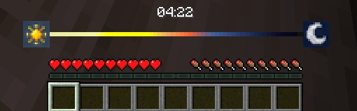

# Day & Night Cycle Bar



A horizontal **day/night cycle HUD bar** for Minecraft Forge, showing the current time of day with a beautiful color gradient timeline.

## ✨ Features

| Feature | Description |
|---------|-------------|
| **🌅 Visual Timeline** | Smooth color transitions: pale yellow → bright yellow → orange → sunset → twilight → midnight |
| **☀️🌙 Sun/Moon Icons** | Animated icons at both ends of the bar |
| **⏰ Time Display** | Optional 24-hour format (HH:MM) above the bar |
| **⚙️ Fully Configurable** | Position, colors, thickness, icons, clock requirement |
| **🌍 Multi-language** | English & Turkish translations |
| **🎮 Game Mode Aware** | Separate visibility for Creative/Survival |
| **⏱️ Clock Requirement** | Optional: only show when holding a clock |

## 📸 Screenshots


*The horizontal bar renders above the hotbar with real-time day/night progression colors.*

## 🎯 Supported Versions

| Minecraft | Forge | Java | Status | Download |
|-----------|-------|------|--------|----------|
| **1.19.4** | 45.4.0 | 17 | ✅ **Working** | [JAR](forge-1.19.4/build/libs/daynightbar-1.0.0.jar) |
| **1.20.1** | 47.2.0 | 17 | ✅ **Working (Tested)** | [JAR](forge-1.20.1/build/libs/daynightbar-1.0.0.jar) |
| 1.20.4 | 49.2.0 | 21 | ⚠️ Structure ready, blocked on mapped artifacts | — |

> **Note:** 1.20.4 module is structurally complete but cannot build due to missing mapped artifacts on Forge Maven. Requires Eclipse Temurin JDK 17 for local compilation fallback.

## 🚀 Installation

1. Download the appropriate JAR for your Minecraft version
2. Place in your `mods/` folder
3. Launch with **Forge** (matching version required)
4. Configure via Mod Menu or `config/daynightbar-common.toml`

## ⚙️ Configuration

All settings accessible via **Mod Menu** or by editing `config/daynightbar-common.toml`:

```toml
[general]
enabled = true
requireClock = false      # Show only when holding a clock
showInCreative = true
showInSurvival = true

[position]
horizontal = "CENTER"     # LEFT, CENTER, RIGHT
vertical = "TOP"          # TOP, BOTTOM
offsetX = 0
offsetY = 10
radius = 50               # Half-width in pixels
thickness = 6             # Bar height in pixels

[appearance]
showTimeText = true
showIcons = true
dayColor = 0xFFFF8800     # ARGB hex
nightColor = 0xFF0044AA
backgroundColor = 0x80000000
textColor = 0xFFFFFFFF
textShadow = true
iconScale = 1.0
smoothAnimation = true
```

## 🛠️ Building from Source

### Prerequisites
- **Java 17** (Microsoft JDK or Eclipse Temurin)
- **Java 21** (for 1.20.4 module)

### Build Commands

```bash
# Build all working versions (1.19.4 & 1.20.1)
export JAVA_HOME="/path/to/jdk-17"
./gradlew :common:build :forge-1.19.4:build :forge-1.20.1:build

# Output JARs:
# forge-1.19.4/build/libs/daynightbar-1.0.0.jar
# forge-1.20.1/build/libs/daynightbar-1.0.0.jar
```

## 📁 Project Structure

```
daynight-bar/
├── build.gradle              # Root config & version catalog
├── settings.gradle           # Plugin management & modules
├── gradle.properties         # Microsoft JDK toolchain paths
├── common/                   # Shared interfaces (ConfigProvider, TimeUtils)
├── forge-1.19.4/             # ✅ MC 1.19.4 + Forge 45.4.0
├── forge-1.20.1/             # ✅ MC 1.20.1 + Forge 47.2.0
└── forge-1.20.4/             # ⚠️ MC 1.20.4 + Forge 49.2.0 (blocked)
```

### Architecture
- **Common module**: Pure Java interfaces (`ConfigProvider`, `TimeUtils`, `ConfigProviderHolder`)
- **Version modules**: Each implements `ConfigProvider` via Forge's `ForgeConfigSpec`
- **Renderers**: 1.19.4 uses `PoseStack`; 1.20.1+ uses `GuiGraphics`

## 🎨 Color Timeline

| Time | Color | Phase |
|------|-------|-------|
| 06:00–11:00 | 🟡 Pale Yellow | Morning |
| 11:00–12:00 | 🟡→🟡 Bright Yellow | Pre-Noon |
| 12:00–15:30 | 🟡 Bright Yellow | Peak Day |
| 15:30–17:00 | 🟠 Pale Orange | Afternoon |
| 17:00–19:00 | 🟠 Sunset Orange | Evening |
| 19:00–21:00 | 🔵 Twilight Blue 1 | Dusk |
| 21:00–00:00 | 🔵 Twilight Blue 2 | Nightfall |
| 00:00–03:00 | 🔵 Midnight Blue | Deep Night |
| 03:00–06:00 | 🔵 Deep Midnight | Pre-Dawn |

## 📝 License

MIT License - see [LICENSE](LICENSE) for details.

## 👤 Author

**emirh** - [GitHub](https://github.com/emirh)

## 🔗 Links

- **Issues**: [GitHub Issues](https://github.com/emirh/daynight-bar/issues)
- **Source**: [GitHub Repository](https://github.com/emirh/daynight-bar)

---

*Made with ❤️ for the Minecraft modding community*